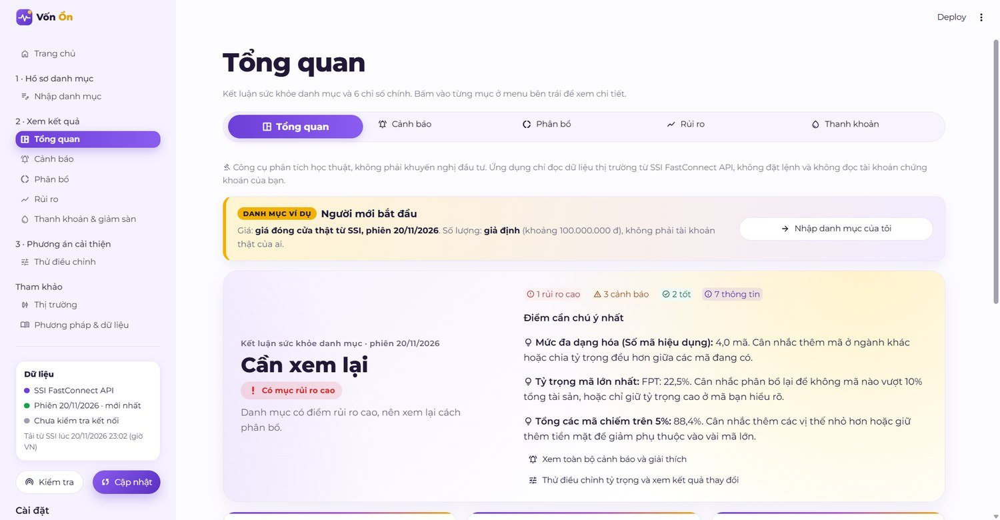
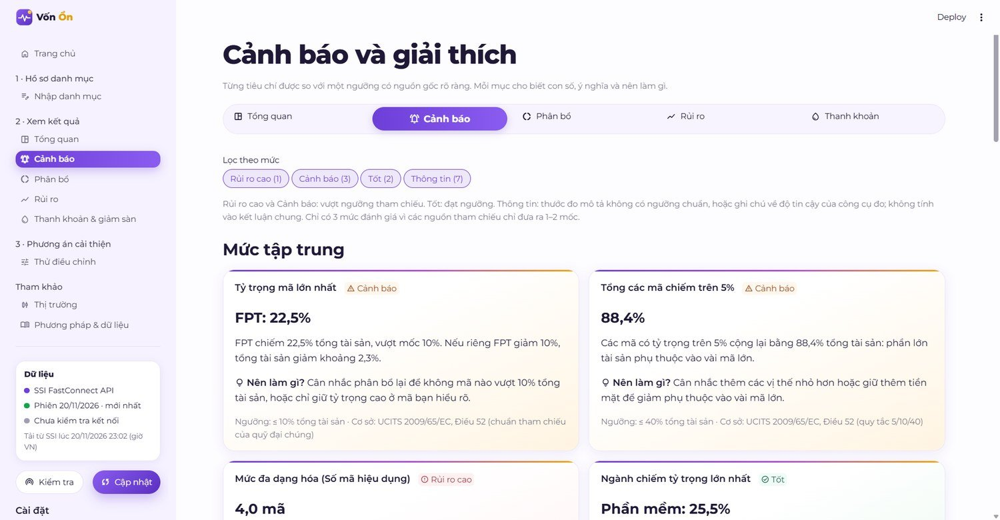
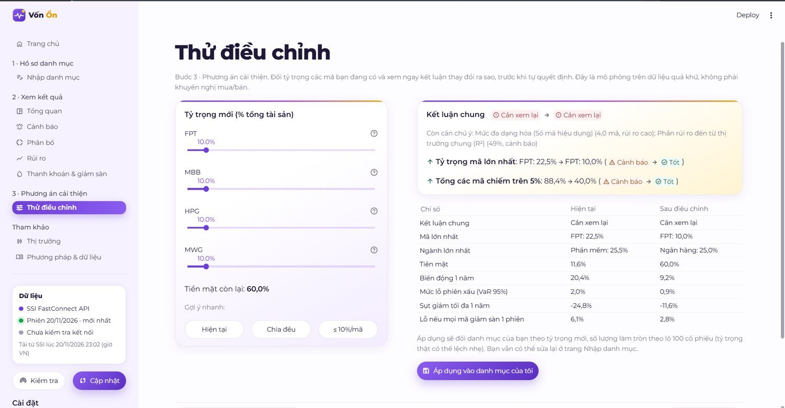
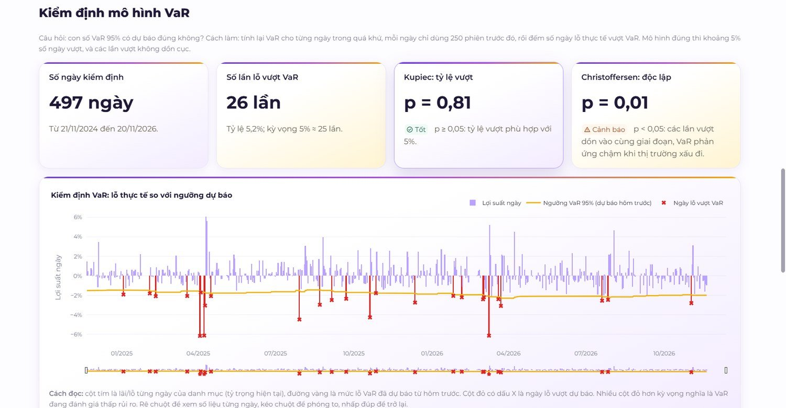
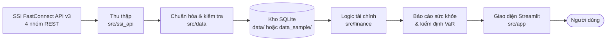

<div align="center">

# Vốn Ổn

### Khám sức khỏe danh mục cổ phiếu cho nhà đầu tư cá nhân

*Khám vốn mỗi phiên, đầu tư an yên.*


</div>

> [!IMPORTANT]
> Vốn Ổn là công cụ phân tích phục vụ học tập, **không phải khuyến nghị đầu tư**. Ứng dụng chỉ đọc dữ liệu thị
> trường công khai từ SSI FastConnect API. Ứng dụng **không đặt lệnh** và **không đọc tài khoản chứng khoán** của
> người dùng.

Đồ án cá nhân cuối kỳ học phần *Gói phần mềm ứng dụng cho tài chính 1*, Trường Đại học Kinh tế – Luật (UEL).

---

## Vốn Ổn giải quyết vấn đề gì?

Nhà đầu tư mới thường chỉ theo dõi lãi lỗ của từng mã. Họ ít khi tự hỏi danh mục của mình có đang khỏe hay không.
Vốn Ổn để người dùng nhập các mã đang nắm và số lượng. Ứng dụng trả lời bốn câu hỏi, dựa trên giá thật từ SSI:

| | Câu hỏi | Ứng dụng đo bằng |
|---|---|---|
| 🎯 | Tiền có đang **dồn vào một chỗ** không? | Tỷ trọng mã lớn nhất, quy tắc 5/10/40, số mã hiệu dụng, tỷ trọng ngành |
| 💧 | Nếu cần tiền gấp, **bán hết mất mấy ngày**? | Số ngày bán hết theo khối lượng bình quân 20 phiên, thời điểm có tiền (T+2) |
| 📈 | Danh mục **lên xuống mạnh** đến đâu? | Độ biến động, beta, R², VaR 95%, sụt giảm tối đa |
| ⚠️ | Nếu cả thị trường **giảm sàn** thì mất bao nhiêu? | Kịch bản mọi mã giảm sàn 1 phiên và 3 phiên liên tiếp |

Mỗi tiêu chí được so với một ngưỡng có nguồn gốc rõ ràng. Mỗi cảnh báo đi kèm phần **"Nên làm gì?"**. Người dùng có thể
thử điều chỉnh tỷ trọng và xem kết luận thay đổi ngay lập tức.

## Ảnh chụp giao diện

| Tổng quan: kết luận và 3 điểm cần chú ý | Cảnh báo: con số, ngưỡng, nguồn và gợi ý |
|:---:|:---:|
|  |  |
| **Thử điều chỉnh: so sánh trước và sau** | **Kiểm định ngoài mẫu mô hình VaR** |
|  |  |

---

## Chạy thử ngay, không cần API key

Kho mã nguồn có sẵn **bản chốt dữ liệu thật** tải từ SSI (`data_sample/sample.db`, chốt ở **phiên 20/11/2026**).
Vì vậy máy không có API key vẫn chạy được đầy đủ ứng dụng.

**Windows (PowerShell)**
```powershell
git clone https://github.com/minhthu6606-stack/GOI-1-BAI-CUOI-KY.git
cd GOI-1-BAI-CUOI-KY
python -m venv .venv
.\.venv\Scripts\Activate.ps1
python -m pip install -r requirements.txt
streamlit run src\app\main.py
```

**macOS / Linux**
```bash
git clone https://github.com/minhthu6606-stack/GOI-1-BAI-CUOI-KY.git
cd GOI-1-BAI-CUOI-KY
python3 -m venv .venv
source .venv/bin/activate
python -m pip install -r requirements.txt
streamlit run src/app/main.py
```

Trình duyệt sẽ tự mở ứng dụng. Ứng dụng nạp sẵn danh mục ví dụ *Người mới bắt đầu*, nên bạn chỉ cần bấm
**Bắt đầu khám**.

> [!TIP]
> PowerShell có thể báo lỗi *"running scripts is disabled"* khi kích hoạt `.venv`. Khi đó chạy lệnh
> `Set-ExecutionPolicy -Scope Process -ExecutionPolicy RemoteSigned` rồi kích hoạt lại. Lệnh này chỉ có hiệu lực
> trong cửa sổ PowerShell hiện tại.

## Một lần khám gồm 3 bước

| Bước | Trang | Người dùng làm gì |
|---|---|---|
| **1 · Hồ sơ danh mục** | Nhập danh mục | Chọn 1 trong 3 danh mục ví dụ hoặc tự nhập: mỗi dòng chỉ cần mã và số lượng, giá vốn là tùy chọn. Có thể khai thêm mức lỗ chịu được (tùy chọn). |
| **2 · Xem kết quả** | Tổng quan · Cảnh báo · Phân bổ · Rủi ro · Thanh khoản | Đọc kết luận chung, các tiêu chí theo mức và biểu đồ chi tiết. 5 trang này có thanh tab để chuyển nhanh. |
| **3 · Phương án cải thiện** | Thử điều chỉnh | Kéo tỷ trọng từng mã, xem kết luận và chỉ số trước/sau, rồi áp dụng vào danh mục nếu muốn. |

Ngoài ra còn hai trang **Thị trường** và **Phương pháp & dữ liệu**: cách tính, nguồn ngưỡng, nhật ký thu thập, chất
lượng dữ liệu và kết quả kiểm định. Cuối mỗi trang có nút **Trước / Tiếp** đi theo đúng thứ tự trên. Khung **Dữ liệu**
ở thanh bên luôn cho biết nguồn, phiên mới nhất, thời điểm tải và trạng thái kết nối.

Ba danh mục ví dụ đều có quy mô khoảng 100 triệu đồng. Giá là giá thật từ SSI, còn số lượng là giả định, được làm
tròn xuống theo lô 100 cổ phiếu:

| Danh mục | Cấu trúc | Kết luận tại phiên 20/11/2026 |
|---|---|---|
| Người mới bắt đầu | FPT, MBB, HPG, MWG (~22,5% mỗi mã) | Cần xem lại |
| Dồn vào ngân hàng | VCB, MBB, ACB, TCB (~22,5% mỗi mã) | Cần xem lại |
| Đa dạng hơn | 8 mã, 7 ngành (~10% mỗi mã) | Cần theo dõi |

---

## Kiến trúc



| Lớp | Thư mục | Nhiệm vụ |
|---|---|---|
| Thu thập | `src/ssi_api/` | Xác thực, giới hạn tần suất 1,1 giây/yêu cầu, thử lại khi lỗi mạng, chia khoảng thời gian dài |
| Chuẩn hóa và lưu trữ | `src/data/` | Đổi kiểu dữ liệu, gắn cờ dòng bẩn, loại trùng, cập nhật tăng dần, lịch phiên, nhật ký thu thập |
| Logic tài chính | `src/finance/` | Định giá danh mục, mức tập trung, thanh khoản, rủi ro thị trường, kịch bản giảm sàn, kiểm định VaR |
| Giao diện | `src/app/` | 10 trang Streamlit, biểu đồ Plotly có tương tác, trạng thái dữ liệu và xử lý lỗi |

## Dữ liệu SSI FastConnect

Theo hướng dẫn của giảng viên, đồ án dùng **SSI FastConnect API v3** làm nguồn dữ liệu chính. Token được cấp **không
kèm OTP**, nên chỉ có quyền đọc dữ liệu thị trường.

| Nhóm API | Dùng để | Ghi chú kỹ thuật |
|---|---|---|
| `securitiesSummary` | Giá, khối lượng, khối ngoại, room ngoại theo phiên của từng mã | Không hỗ trợ lật trang, tối đa 100 bản ghi/lần → chia đoạn 120 ngày |
| `ohlc` | Nến ngày của VN-Index (lịch giao dịch chuẩn, tính beta) | Chia đoạn tối đa 1 năm |
| `securitiesByBoard` | Danh sách mã, ngành, số cổ phiếu niêm yết | Làm mới mỗi tuần |
| `indexSummary` | Tổng hợp thị trường HOSE: độ rộng, thanh khoản, khối ngoại | 20 phiên gần nhất |

**Quy tắc thu thập.** Lần đầu, ứng dụng tải 3 năm lịch sử. Các lần sau chỉ tải phần mới, nhưng lùi lại 14 ngày
(chồng lấp). Cách này giúp phát hiện giá lịch sử bị điều chỉnh do chia cổ tức, và tự tải bù khi máy nghỉ nhiều phiên.
Giá chỉ được coi là chốt sau 15:00. Mỗi lần tải được ghi vào nhật ký, kèm phiên và thời điểm.

**Kho dữ liệu SQLite** gồm 6 bảng:

| Bảng | Khóa | Nội dung |
|---|---|---|
| `stock_daily` | `symbol`, `trading_date` | Giá đóng/mở/cao/thấp đã điều chỉnh, khối lượng, giá trị, khối ngoại, room ngoại, cờ chất lượng, thời điểm tải |
| `index_daily` | `symbol`, `trading_date` | Chuỗi VN-Index theo phiên |
| `securities` | `symbol` | Tên công ty, sàn, ngành ICB, số cổ phiếu niêm yết |
| `market_summary` | `board`, `trading_date` | Độ rộng thị trường, thanh khoản, giao dịch khối ngoại theo sàn |
| `fetch_log` | `id` | Nhật ký từng lần tải: phiên, khoảng ngày, số bản ghi nhận/giữ/gắn cờ, phiên thiếu, trạng thái |
| `raw_responses` | `id` | Phản hồi gốc từ SSI để truy vết (không đưa vào bản chốt) |

Từ điển dữ liệu chi tiết nằm ở Phụ lục A của báo cáo.

## Phương pháp tài chính

Ứng dụng chấm 13 tiêu chí theo bốn mức: **Rủi ro cao**, **Cảnh báo**, **Tốt** và **Thông tin**. **Kết luận chung lấy
mức xấu nhất**, tức là chỉ cần một chỉ số vượt ngưỡng nghiêm trọng là danh mục cần xem lại. Các tiêu chí ở mức Thông
tin không tính vào kết luận.

| Nhóm | Tiêu chí | Ngưỡng | Cơ sở |
|---|---|---|---|
| Tập trung | Tỷ trọng mã lớn nhất | ≤ 10% | UCITS 2009/65/EC, Điều 52 |
| Tập trung | Tổng các mã chiếm trên 5% | ≤ 40% | UCITS, quy tắc 5/10/40 |
| Tập trung | Số mã hiệu dụng (1/HHI) | ≥ 10 tốt; < 5 rủi ro cao | Evans & Archer (1968) |
| Tập trung | Ngành lớn nhất | ≤ 50% phần cổ phiếu | Quy tắc tự đặt |
| Thanh khoản | Tài sản cần trên 5 ngày làm việc mới có tiền | ≤ 15% | SEC Rule 22e-4; bán tối đa 20% khối lượng bình quân 20 phiên, T+2 |
| Rủi ro | Độ biến động năm | So với VN-Index | Độ lệch chuẩn × √252 |
| Rủi ro | Beta | So với 1 | Sharpe (1964) |
| Rủi ro | R² | ≥ 50% | Mô hình chỉ số đơn, Sharpe (1963) |
| Rủi ro | VaR 95% một phiên | Mức tự khai (tùy chọn) | Mô phỏng lịch sử 250 phiên, Jorion (2007) |
| Rủi ro | Độ tin cậy của VaR | Thông tin | Kupiec (1995), Christoffersen (1998) |
| Rủi ro | Sụt giảm tối đa 1 năm | Mức tự khai (tùy chọn) | Từ đỉnh xuống đáy của giá trị danh mục |
| Kịch bản | Mọi mã giảm sàn 1 và 3 phiên | Thông tin | Biên độ HOSE 7%, HNX 10%, UPCoM 15% |
| Khối ngoại | Room ngoại còn lại | Thông tin | Dữ liệu room của SSI |

---

## Kiểm thử và kiểm chứng

```powershell
python -m pytest -q                         # 110 kiểm thử tự động, không cần mạng và không cần key
python scripts\test_error_scenarios.py      # 9 tình huống lỗi -> docs\kiem_chung\thu_loi.md
python scripts\verification_report.py       # chất lượng dữ liệu, nhật ký, kiểm định VaR -> docs\kiem_chung\
python scripts\update_data.py --sessions    # nhật ký thu thập theo phiên
```

Kết quả trên bản chốt phiên 20/11/2026 (chi tiết trong [`docs/kiem_chung/`](docs/kiem_chung/)):

- **Dữ liệu:** 16 mã × 748 phiên (20/11/2023–20/11/2026), không thiếu phiên nào so với lịch VN-Index, không có dòng
  bị gắn cờ. Đối chiếu chéo 11.952 phiên chỉ thấy 1 phiên lệch, và đó là lỗi ở trường thay đổi giá của nguồn, không ở
  chuỗi giá đóng cửa.
- **Tình huống lỗi:** đạt cả 9 tình huống: thiếu key, sai key, mất kết nối, mã không tồn tại, giới hạn tần suất,
  danh mục nhập sai, dữ liệu bẩn, nghỉ nhiều phiên rồi mở lại, dữ liệu đến muộn.
- **Kiểm định VaR ngoài mẫu** (497 ngày):

  | Danh mục | Tỷ lệ vượt | Kupiec p-value | Christoffersen p-value |
  |---|---|---|---|
  | Người mới bắt đầu | 5,23% | 0,814 (đạt) | 0,009 (không đạt) |
  | Dồn vào ngân hàng | 6,64% | 0,109 (đạt) | 0,004 (không đạt) |
  | Đa dạng hơn | 5,43% | 0,662 (đạt) | 0,002 (không đạt) |

  Tỷ lệ vượt khớp mức kỳ vọng 5%, nhưng các lần vượt dồn vào cùng giai đoạn. Đây là điểm yếu đã biết của VaR lịch sử.
  Ứng dụng nêu rõ điểm này trên giao diện, thay vì chỉ trình bày kết quả đẹp.

## Dùng với dữ liệu trực tiếp từ SSI (cần API key)

1. Đăng ký API key tại [SSI Developer Portal](https://developers.ssi.com.vn). Chỉ cần quyền **All api data**. Không
   cấp quyền giao dịch.
2. Tạo file cấu hình rồi điền key vào **`.env`**:
   ```powershell
   Copy-Item .env.example .env
   ```
   > ⚠️ Chỉ điền key vào `.env`. File này đã bị `.gitignore` chặn. Luôn để trống `.env.example`, vì file đó được đưa
   > lên GitHub.
3. Tải dữ liệu rồi mở ứng dụng:
   ```powershell
   python scripts\update_data.py              # lần đầu: 3 năm cho 16 mã, khoảng 2–3 phút
   streamlit run src\app\main.py
   ```

Khi có key và kho `data/`, mở ứng dụng sau 15:00 ngày làm việc sẽ **tự tải phiên mới** (mỗi phiên một lần). Bạn cũng có
thể bấm **Cập nhật** ở thanh bên. Các lệnh khác:

| Lệnh | Tác dụng |
|---|---|
| `python scripts\update_data.py --symbols FPT ACB` | Tải hoặc cập nhật các mã chỉ định |
| `python scripts\update_data.py --status` | Xem kho đang có gì, không tải |
| `python scripts\portfolio_report.py --example banks` | In báo cáo sức khỏe một danh mục ví dụ ra màn hình |
| `python scripts\check_ssi_connection.py` | Kiểm tra kết nối và định dạng dữ liệu SSI |
| `powershell -ExecutionPolicy Bypass -File scripts\dang_ky_cap_nhat_tu_dong.ps1` | Đăng ký tự cập nhật 15:30 thứ Hai–thứ Sáu (Windows) |

## Cấu trúc thư mục

```text
GOI-1-BAI-CUOI-KY/
├── src/
│   ├── config.py              cấu hình chung: đường dẫn, múi giờ, tham số SSI, danh sách mã
│   ├── ssi_api/client.py      gọi SSI: xác thực, giới hạn tần suất, thử lại
│   ├── data/                  chuẩn hóa, kho SQLite, cập nhật tăng dần, lịch phiên, chất lượng dữ liệu
│   ├── finance/               danh mục, tập trung, thanh khoản, rủi ro, giảm sàn, kiểm định VaR,
│   │                          báo cáo sức khỏe, danh mục ví dụ, thử điều chỉnh
│   └── app/                   ứng dụng Streamlit: điều hướng, các trang, biểu đồ, giao diện
├── scripts/                   cập nhật dữ liệu, xuất bản chốt, báo cáo kiểm chứng, thử lỗi
├── tests/                     110 kiểm thử tự động (pytest)
├── data_sample/sample.db      bản chốt dữ liệu SSI thật, phiên 20/11/2026
├── docs/kiem_chung/           kết quả kiểm chứng sinh tự động từ dữ liệu thật
├── docs/hinh_anh/             ảnh chụp giao diện
├── .streamlit/config.toml     màu giao diện sáng/tối, phông chữ
├── .env.example               tên các biến cấu hình (để trống)
└── requirements.txt
```

## Giới hạn đã biết

- Dữ liệu **theo phiên** (cuối ngày), không phải thời gian thực.
- Chỉ dùng một nguồn là SSI. Nguồn này vẫn có thể có sai sót, ví dụ trường thay đổi giá của ACB ngày 03/07/2025.
- Bản chốt chỉ gồm **16 mã** và dừng ở phiên 20/11/2026. Trên máy không có key, danh mục có mã khác sẽ không được
  tính đủ, và ứng dụng sẽ báo rõ mã thiếu dữ liệu.
- Các chỉ số dựa trên quá khứ và giả định tỷ trọng cố định. VaR không cho biết mức lỗ trong 5% số phiên xấu nhất.
- Ngưỡng UCITS và SEC là chuẩn tham chiếu của quỹ đầu tư, không bắt buộc với nhà đầu tư cá nhân. Ngưỡng ngành 50%
  và tỷ lệ bán 20% khối lượng bình quân là quy ước của đồ án.
- Chưa tính thuế, phí giao dịch, cổ tức tiền mặt và lãi tiền gửi.
- *Thử điều chỉnh* là mô phỏng trên dữ liệu quá khứ, không phải khuyến nghị mua hay bán.

## Bảo mật

- Key và secret chỉ nằm trong `.env` trên máy người dùng. Không có thông tin xác thực nào trong mã nguồn.
- Ứng dụng chỉ lấy access token không kèm OTP, nên không thể đặt, sửa hay hủy lệnh.
- Ứng dụng không đọc tài khoản chứng khoán. Danh mục do người dùng tự nhập và chỉ lưu trong phiên làm việc.

---

<div align="center">

**Lê Thị Minh Thư** · Công nghệ Tài chính, Trường Đại học Kinh tế – Luật (UEL)

Đồ án cá nhân cuối kỳ · *Gói phần mềm ứng dụng cho tài chính 1* · 2026

</div>
